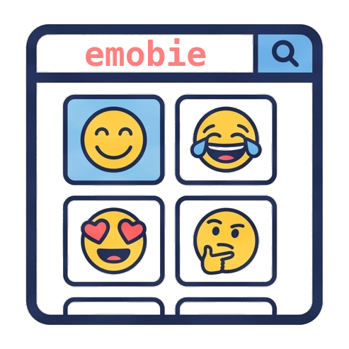

<p align="center">
  
</p>

<h1 align="center">emobie</h1>

[](https://ko-fi.com/U5R225QZH3)

<p align="center">
  <strong>Compact Linux-first emoji palette for content creators</strong>
</p>

<p align="center">
  Browse the full Unicode set · search · copy · pin · tray · global hotkey
</p>

<p align="center">
  <a href="https://github.com/asafelobotomy/emobie/releases/latest"></a>
  <a href="LICENSE"></a>
  <a href="https://github.com/asafelobotomy/emobie/releases"></a>
  <a href="https://github.com/asafelobotomy/emobie/actions/workflows/ci.yml"></a>
</p>

<p align="center">
  <a href="#install">Install</a> ·
  <a href="#features">Features</a> ·
  <a href="#develop">Develop</a> ·
  <a href="#build--package">Build</a> ·
  <a href="CHANGELOG.md">Changelog</a>
</p>

---

## Install

Grab the latest build from
[**GitHub Releases**](https://github.com/asafelobotomy/emobie/releases/latest).

| Format | Best for | How |
|--------|----------|-----|
| **Flatpak** | Sandboxed desktop install | `flatpak install --user emobie-*-x86_64.flatpak` — Auto-paste auto-installs the host helper |
| **`.deb`** | Debian / Ubuntu / Mint / Pop | `sudo apt install ./emobie_*_amd64.deb` |
| **`.rpm`** | Fedora / RHEL / openSUSE | `sudo dnf install ./emobie-*-1.x86_64.rpm` (openSUSE: `zypper install …`) |
| **AppImage** | Portable / Arch / CachyOS | `chmod +x emobie_*.AppImage && ./emobie_*.AppImage` — Auto-paste auto-installs the host helper |

Arch / CachyOS / Manjaro: see [`docs/LINUX.md`](docs/LINUX.md) and optional [`packaging/arch/PKGBUILD`](packaging/arch/PKGBUILD).

```bash
# Flatpak (after downloading the release bundle)
flatpak install --user emobie-*-x86_64.flatpak
flatpak run io.github.asafelobotomy.emobie
```

App ID: `io.github.asafelobotomy.emobie`

Linux tray, pin, startup, and SELinux notes: [`docs/LINUX.md`](docs/LINUX.md).

---

## Features

| | |
|---|---|
| **Catalog** | Full Unicode emoji set via emojibase, with categories and search (name, tags, shortcodes) |
| **Favorites & recents** | Right-click to favorite; recent history with configurable size |
| **Macros** | Custom trigger → expansion cards (+ to add), optional favorited-emoji shortcodes/emoticons, per-macro hotkeys, YAML import/export |
| **Updates** | Optional startup check; Settings can download and install the matching release asset (deb/rpm/AppImage/Flatpak) |
| **Copy** | One-click clipboard copy; optional auto-paste when the host input helper is available |
| **Expand** | Opt-in as-you-type text expansion: type a trigger anywhere to replace it (one admin prompt for keyboard access — see [docs/MACROS.md](docs/MACROS.md)) |
| **Summon** | Global hotkey (default `Ctrl+Shift+Space`; letters/numbers need a modifier) and system tray |
| **Layout** | Resize freely — horizontal, square, or vertical; frameless by default (optional title bar in Settings) |
| **Pin** | Always-on-top from the toolbar or tray (X11, Plasma Wayland, and GNOME Wayland after a one-time shortcut setup in Settings; other Wayland compositors may ignore) |
| **Look** | Light / dark / system theme, emoji size, and skin tone defaults |
| **Sort** | Default order, name, type, first used, or number of uses |
| **uQ** | On the [uQ](https://github.com/asafelobotomy/uq) desktop: type `:` in Spotlight to search emoji (favourites and recents first; Enter copies, Shift+Enter types), and emobie follows uQ's theme — see [uq/README.md](uq/README.md) |

**Tray:** left-click shows emobie · right-click for Show / Hide / Pin / Quit  
**Close:** hides to tray — quit from Settings or the tray menu

---

## Develop

**Prerequisites**

- Node.js 22.6+ (`npm test` uses `--experimental-strip-types`)
- Rust (stable)

Debian / Ubuntu:

```bash
sudo apt update
sudo apt install -y \
  libwebkit2gtk-4.1-dev \
  libayatana-appindicator3-dev \
  librsvg2-dev \
  patchelf \
  build-essential \
  curl wget file \
  libssl-dev \
  libxdo-dev
```

Fedora:

```bash
sudo dnf install \
  webkit2gtk4.1-devel \
  libayatana-appindicator-gtk3-devel \
  librsvg2-devel \
  openssl-devel
```

**Run**

```bash
npm install
npm run tauri dev
```

```bash
npm test          # unit smoke tests
npm run build     # frontend typecheck + Vite build
npm run test:provider   # emobie-provider (uQ launcher), incl. a private D-Bus test
```

**Emoji data.** `src/data/emoji.json` is generated from emojibase by
`npm run emoji:build` and committed; the app imports it and packages install it
as `/usr/share/emobie/emoji.json` for `emobie-provider`. After bumping
`emojibase-data` or editing `src/data/extraEmoticons.ts`, run `npm run emoji:build`
(CI's `npm run emoji:check` fails on a stale file).

**uq-tokens.** `src/vendor/uq-tokens/` is vendored from uQ's `web/uq-tokens`
(`uq-tokens.js` unchanged; `uq-tokens.css` holds emobie's palette as fallbacks).
To update, copy the new `uq-tokens.js` over it and bump the version pinned in
`package.json`'s `check:uq-tokens` script.

---

## Build & package

Prefer the packaged npm scripts so AppImage post-processing always runs
(WebKit helpers, `Exec=`, `inputd-host-bundle.tgz`):

```bash
npm run tauri:build
```

Artifacts land in `src-tauri/target/release/bundle/`.

On Arch / CachyOS (and some other rolling distros), AppImage bundling needs
`NO_STRIP=true` so linuxdeploy’s outdated `strip` doesn’t choke on `.relr.dyn`
sections. If the linuxdeploy AppImage itself won’t run, also set
`APPIMAGE_EXTRACT_AND_RUN=1` (already set by `tauri:build`).

```bash
# One format (always run the fix script after AppImage builds)
npm run tauri build -- --bundles deb
npm run tauri build -- --bundles rpm
NO_STRIP=true APPIMAGE_EXTRACT_AND_RUN=1 npm run tauri build -- --bundles appimage \
  && bash scripts/fix-linux-bundle-icons.sh

# All three
npm run tauri:build
```

### Flatpak (GitHub Releases — from a `.deb`)

```bash
npm run tauri build -- --bundles deb
cp src-tauri/target/release/bundle/deb/*.deb flatpak/emobie.deb

flatpak install -y flathub org.gnome.Platform//50 org.gnome.Sdk//50
flatpak-builder --force-clean --user --repo=flatpak/repo flatpak/build-dir \
  flatpak/io.github.asafelobotomy.emobie.deb.yml
flatpak build-bundle flatpak/repo emobie.flatpak io.github.asafelobotomy.emobie
flatpak install --user emobie.flatpak
```

A separate **source-build** manifest ([`flatpak/io.github.asafelobotomy.emobie.yml`](flatpak/io.github.asafelobotomy.emobie.yml)) is prepared for a future Flathub submission. Flathub listing is **deferred** until the checklist in [`docs/FLATHUB.md`](docs/FLATHUB.md) is green.
---

## Releases

Tags matching `vX.Y.Z` run GitHub Actions to publish **`.deb`**, **`.rpm`**, **AppImage**, and **Flatpak**, with notes from [`CHANGELOG.md`](CHANGELOG.md).

```bash
# Keep package.json, Cargo.toml, and tauri.conf.json versions in sync
git tag v0.6.10
git push origin v0.6.10
```

Or run the **Release** workflow from the Actions tab.

---

## Notes

- Global shortcuts and tray icons can differ on Wayland vs X11 depending on your compositor. On **GNOME**, install an AppIndicator / KStatusNotifierItem extension for the tray ([details](docs/LINUX.md)).
- Optional **auto-paste** injects a Ctrl+V via host `emobie-inputd` (see [docs/MACROS.md](docs/MACROS.md)); **Expand as you type** additionally reads the keyboard while on. Clipboard copy always works without the helper. Diagnose setup with `npm run verify:expand`.
- Flatpak preferences live under
  `~/.var/app/io.github.asafelobotomy.emobie/…`; native under
  `~/.local/share/io.github.asafelobotomy.emobie/…` (older native builds used
  `com.emobie.app`). A durable mirror at
  `~/.local/share/emobie/preferences.json` keeps favorites/macros across both.
- Under **uQ**, Super+. opens uQ's emoji search, so emobie's own summon hotkey stays off
  (emobie checks for `org.uq.Desktop1` on the session bus when it starts; macro hotkeys still
  work). emobie's look follows uQ's theme while Settings → Theme is "System". Native packages
  only: the Flatpak sandbox does not see uQ's bus name or theme file, so it keeps its own
  hotkey and theme.
- Pin is reliable on X11 and Plasma Wayland. On GNOME Wayland it needs a one-time shortcut
  setup (Settings → "Set up GNOME pin shortcut") since Mutter has no external always-on-top
  API — emobie binds GNOME's own unused `toggle-above` keybinding instead. Other Wayland
  compositors may still ignore pin.

---

## License

[MIT](LICENSE) © aSafeLobotomy
